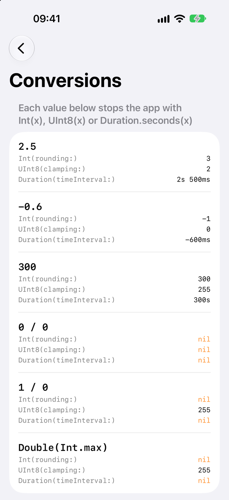
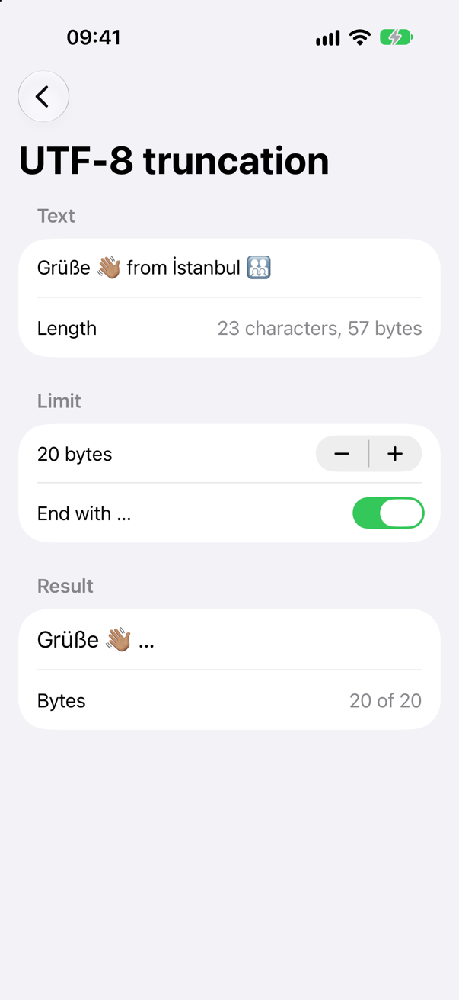
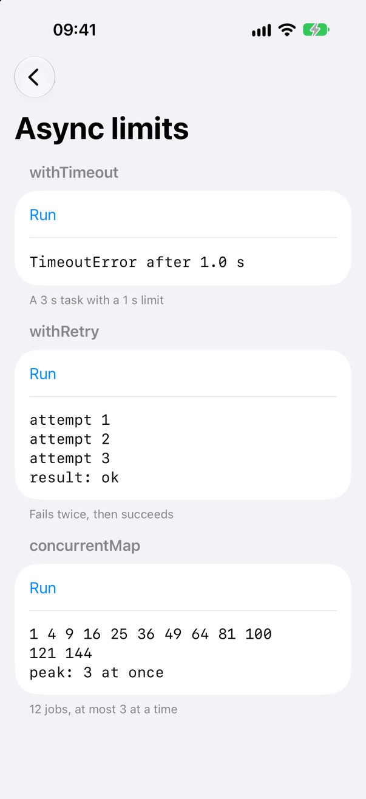
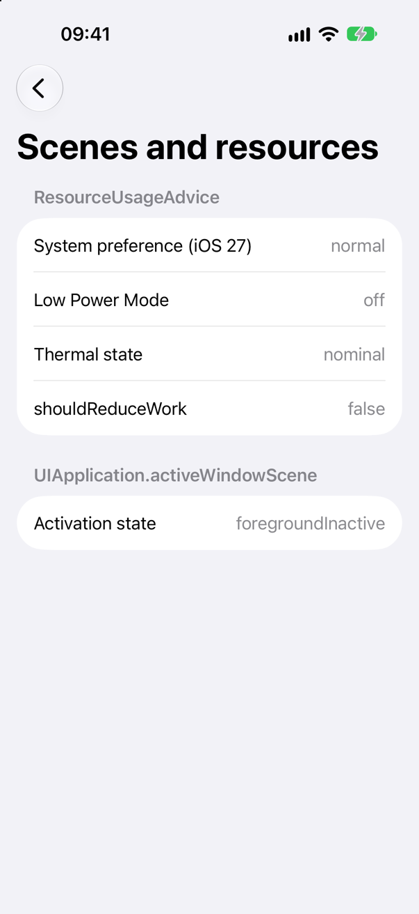

<!-- i18n-source: README.md@c00d9955298fc27d6c0cca3e349200338c272d46 status=reviewed -->
<!-- brand:start -->

<p align="center"><picture><source media="(prefers-color-scheme: dark)" srcset="https://raw.githubusercontent.com/muhittincamdali/SwiftExtensions/main/.github/brand/banner-dark.svg"><source media="(prefers-color-scheme: light)" srcset="https://raw.githubusercontent.com/muhittincamdali/SwiftExtensions/main/.github/brand/banner-light.svg"></picture></p>

<!-- lang-selector:start -->
<p align="center"><a href="README.md">English</a> · <a href="README.tr.md">Türkçe</a> · <a href="README.zh-CN.md">简体中文</a> · <a href="README.ja.md">日本語</a> · <a href="README.ko.md">한국어</a> · <a href="README.es.md">Español</a> · <a href="README.de.md">Deutsch</a> · <a href="README.fr.md">Français</a> · <a href="README.pt-BR.md">Português (Brasil)</a> · <a href="README.ru.md">Русский</a></p>
<!-- lang-selector:end -->

<p align="center">
<a href="https://github.com/muhittincamdali/SwiftExtensions/actions/workflows/ci.yml"></a>
<a href="https://github.com/muhittincamdali/SwiftExtensions/releases"><picture><source media="(prefers-color-scheme: dark)" srcset="https://raw.githubusercontent.com/muhittincamdali/SwiftExtensions/main/.github/brand/badge-version-dark.svg"><source media="(prefers-color-scheme: light)" srcset="https://raw.githubusercontent.com/muhittincamdali/SwiftExtensions/main/.github/brand/badge-version-light.svg"></picture></a>
<a href="https://github.com/muhittincamdali/SwiftExtensions/blob/main/Package.swift"><picture><source media="(prefers-color-scheme: dark)" srcset="https://raw.githubusercontent.com/muhittincamdali/SwiftExtensions/main/.github/brand/badge-platforms-dark.svg"><source media="(prefers-color-scheme: light)" srcset="https://raw.githubusercontent.com/muhittincamdali/SwiftExtensions/main/.github/brand/badge-platforms-light.svg"></picture></a>
<a href="https://github.com/muhittincamdali/SwiftExtensions/blob/main/Package.swift"><picture><source media="(prefers-color-scheme: dark)" srcset="https://raw.githubusercontent.com/muhittincamdali/SwiftExtensions/main/.github/brand/badge-language-dark.svg"><source media="(prefers-color-scheme: light)" srcset="https://raw.githubusercontent.com/muhittincamdali/SwiftExtensions/main/.github/brand/badge-language-light.svg"></picture></a>
<a href="https://github.com/muhittincamdali/SwiftExtensions/blob/main/LICENSE"><picture><source media="(prefers-color-scheme: dark)" srcset="https://raw.githubusercontent.com/muhittincamdali/SwiftExtensions/main/.github/brand/badge-license-dark.svg"><source media="(prefers-color-scheme: light)" srcset="https://raw.githubusercontent.com/muhittincamdali/SwiftExtensions/main/.github/brand/badge-license-light.svg"></picture></a>
</p>

<p align="center">
<a href="#démarrage-rapide"><picture><source media="(prefers-color-scheme: dark)" srcset="https://raw.githubusercontent.com/muhittincamdali/SwiftExtensions/main/.github/brand/button-start-fr-dark.svg"><source media="(prefers-color-scheme: light)" srcset="https://raw.githubusercontent.com/muhittincamdali/SwiftExtensions/main/.github/brand/button-start-fr-light.svg"></picture></a>
<a href="https://muhittincamdali.github.io/SwiftExtensions/documentation/swiftextensions/"><picture><source media="(prefers-color-scheme: dark)" srcset="https://raw.githubusercontent.com/muhittincamdali/SwiftExtensions/main/.github/brand/button-docs-fr-dark.svg"><source media="(prefers-color-scheme: light)" srcset="https://raw.githubusercontent.com/muhittincamdali/SwiftExtensions/main/.github/brand/button-docs-fr-light.svg"></picture></a>
<a href="https://github.com/muhittincamdali/SwiftExtensions/tree/main/Examples"><picture><source media="(prefers-color-scheme: dark)" srcset="https://raw.githubusercontent.com/muhittincamdali/SwiftExtensions/main/.github/brand/button-examples-fr-dark.svg"><source media="(prefers-color-scheme: light)" srcset="https://raw.githubusercontent.com/muhittincamdali/SwiftExtensions/main/.github/brand/button-examples-fr-light.svg"></picture></a>
</p>

> Ceci est une traduction du README anglais. En cas de différence, la version anglaise fait foi.

<!-- brand:end -->

SwiftExtensions est un petit paquet Swift d’extensions que la bibliothèque standard, Foundation et [SwifterSwift](https://github.com/SwifterSwift/SwifterSwift) ne proposent pas : limites de temps, nouvelles tentatives et travail parallèle borné pour Swift concurrency, conversions qui renvoient `nil` là où les initialiseurs de Swift arrêtent l’app, limites de taille pour les téléchargements et le texte, et utilitaires pour le cycle de vie des scènes et la préférence de ressources réduites d’iOS 27. Il fonctionne sur iOS 18+, macOS 15+, tvOS 18+, watchOS 11+ et visionOS 2+ et n’a aucune dépendance.

**En quoi il diffère de SwifterSwift :** SwifterSwift est une vaste collection d’utilitaires pratiques (des centaines d’extensions pour les chaînes, les collections, les couleurs et UIKit). Ce paquet est l’inverse : des extensions dans dix domaines précis, qu’aucune extension de SwifterSwift ne couvre, chacune correcte vis-à-vis de `Sendable` avec la concurrence stricte de Swift 6, testée dans ses cas limites et documentée avec la raison de son existence. Utilisez SwifterSwift pour les utilitaires pratiques et ce paquet pour les cas ci-dessous ; les deux peuvent être importés ensemble.

## Points forts

- **Des conversions qui n’arrêtent pas l’app** — `Int(rounding:)`, `UInt8(clamping:)` et `Duration(timeInterval:)` renvoient `nil` pour NaN, l’infini et les valeurs hors limites, là où `Int(_:)` et `Duration.seconds(_:)` arrêtent l’app.
- **Limites de temps et nouvelles tentatives** — `withTimeout` annule le travail qui dure trop longtemps ; `withRetry` temporise de façon exponentielle avec du jitter, ne réessaie jamais une annulation, et sa `RetryPolicy` corrige les valeurs invalides, afin qu’une configuration distante ne puisse ni le faire boucler ni arrêter l’app.
- **Travail parallèle avec une limite** — `concurrentMap(maxConcurrency:)` conserve l’ordre de l’entrée, exécute au plus N transformations à la fois et utilise typed throws : aucun `try` pour une transformation qui ne peut pas lever d’erreur.
- **Limites de taille** — `collect(limit:)` et `URLSession.data(for:limit:)` arrêtent la lecture à la limite au lieu de remplir la mémoire ; `truncated(toUTF8ByteCount:)` garde le texte dans un budget d’octets sans couper un emoji en deux.
- **iOS 27** — `UIApplication.activeWindowScene` et `activeKeyWindow` remplacent `windows` et `keyWindow`, obsolètes, pour le cycle de vie des scènes qu’exige iOS 27, et `ResourceUsageAdvice` combine la préférence de ressources réduites d’iOS 27 avec le mode économie d’énergie et l’état thermique à partir d’iOS 18.
- **Concurrence stricte de Swift 6** — chaque type public est `Sendable`, chaque closure indique son isolation, et le paquet compile sans avertissement dans le mode de langage Swift 6.
- **Testé** — 89 tests Swift Testing sur macOS, dont les exemples du README ; les mêmes tests plus ceux d’UIKit sur un simulateur iOS, et 7 tests d’interface qui pilotent l’app d’exemple.

## Démarrage rapide

**1. Ajouter le paquet**

Dans Xcode, choisissez **File › Add Package Dependencies…** et collez l’URL du dépôt dans le champ de recherche en haut à droite :

```text
https://github.com/muhittincamdali/SwiftExtensions.git
```

Laissez **Dependency Rule** sur **Up to Next Major Version** à partir de `2.0.0` et cliquez sur **Add Package**. Dans la fenêtre suivante, choisissez la cible de votre app à côté de **SwiftExtensions** et cliquez de nouveau sur **Add Package**.

**2. Importer le module**

```swift
import SwiftExtensions
```

Placez cette ligne en haut de chaque fichier Swift qui utilise les extensions.

**3. L’utiliser**

Dans une nouvelle app Xcode (**File › New › Project… › App**), remplacez tout le contenu de `ContentView.swift` par :

```swift
import SwiftExtensions
import SwiftUI

struct ContentView: View {
    @State private var status = "Not started"

    var body: some View {
        VStack(spacing: 16) {
            Text("Int(rounding: 0.0 / 0.0) is \(Int(rounding: 0.0 / 0.0) ?? -1)")
            Text("Grüße 👋🏽".truncated(toUTF8ByteCount: 9, ending: "…"))
            Button("Wait 3 s with a 1 s limit") {
                Task { status = await waitWithLimit() }
            }
            Text(status)
        }
    }
}

func waitWithLimit() async -> String {
    do {
        try await withTimeout(.seconds(1)) {
            try await Task.sleep(for: .seconds(3))
        }
        return "Finished"
    } catch is TimeoutError {
        return "Stopped after 1 second"
    } catch {
        return "Cancelled"
    }
}
```

Appuyez sur **Run** (⌘R). La première ligne affiche `-1`, car `Int(rounding:)` a renvoyé `nil` pour NaN alors que `Int(0.0 / 0.0)` aurait arrêté l’app. La deuxième ligne affiche `Grüß…` : 9 octets d’UTF-8 avec les points de suspension. Le bouton lance une tâche de 3 secondes et affiche **Stopped after 1 second**.

## Installation

### Swift Package Manager

Dans Xcode, choisissez **File › Add Package Dependencies…** et saisissez `https://github.com/muhittincamdali/SwiftExtensions.git`, ou ajoutez-le aux `dependencies` de votre `Package.swift` :

```swift
dependencies: [
    .package(url: "https://github.com/muhittincamdali/SwiftExtensions.git", from: "2.0.0")
],
targets: [
    .target(name: "YourApp", dependencies: [
        .product(name: "SwiftExtensions", package: "SwiftExtensions")
    ])
]
```

### Prérequis

| | Minimum |
| --- | --- |
| Swift | 6.2 (Xcode 26 ou version ultérieure) |
| Plateformes | iOS 18, macOS 15, tvOS 18, watchOS 11, visionOS 2 |
| `ResourceUsageAdvice.current(traitCollection:)` | SDK iOS 27 (Xcode 27) |

La version 2.0.0 remplace l’API de la 1.0.0 de février 2026, un vaste ensemble d’utilitaires pratiques qui reprenaient surtout SwifterSwift ; en juin 2026, ces sources ont été remplacées par du code factice. La 2.0.0 est un nouveau paquet, plus petit, construit et testé pour le mode de langage Swift 6. [CHANGELOG.md](CHANGELOG.md) liste les changements.

## Utilisation

Les exemples ci-dessous sont compilés et exécutés par les tests ([`ReadmeSamples.swift`](Examples/ExtensionsDemo/ExtensionsDemo/ReadmeSamples.swift)).

### Des conversions qui n’arrêtent pas l’app

```swift
func progressLabel(done: Double, total: Double) -> String {
    // done / total is NaN when both are 0 and infinity when only total is 0.
    guard let percent = Int(rounding: done / total * 100) else { return "–" }
    return "\(percent) %"
}

func retryDelay(fromHeader value: String?) -> Duration {
    // "Retry-After: 1e400" parses as infinity; Duration.seconds(_:) would stop the app.
    guard let seconds = value.flatMap(Double.init), seconds >= 0 else { return .seconds(5) }
    return Duration(timeInterval: seconds) ?? .seconds(5)
}
```

| Appel | Renvoie `nil` pour |
| --- | --- |
| `Int(rounding: x, rule)` | NaN, ±l’infini, une valeur arrondie hors des limites du type |
| `UInt8(clamping: x)` | NaN uniquement ; les autres valeurs sont ramenées à `min` ou `max` |
| `Duration(timeInterval: x)` | NaN, ±l’infini, une magnitude de 2⁶³ secondes ou plus |

`Duration.timeInterval` convertit dans l’autre sens, et `Date.advanced(by: .seconds(30))` accepte une `Duration`.

### Limites de temps, nouvelles tentatives et travail parallèle

```swift
protocol PhotoLibrary: Sendable {
    func thumbnail(for id: Int) async throws -> Data
}

func thumbnails(for ids: [Int], from library: some PhotoLibrary) async throws -> [Data] {
    try await withTimeout(.seconds(10)) {
        try await ids.concurrentMap(maxConcurrency: 4) { id in
            try await withRetry(RetryPolicy(maxAttempts: 3)) { _ in
                try await library.thumbnail(for: id)
            }
        }
    }
}
```

- `withTimeout` lève `TimeoutError` une fois la limite atteinte et annule l’opération. L’annulation est coopérative : une opération qui ne la vérifie jamais retarde l’erreur jusqu’à son retour.
- `withRetry` attend `initialDelay × multiplier^(n − 1)`, au plus `maxDelay`, diminué d’une part pouvant aller jusqu’à `jitter`. Il s’exécute sur l’acteur de l’appelant et ne réessaie jamais `CancellationError`.
- `concurrentMap` renvoie les résultats dans l’ordre de `ids`. La première erreur annule les transformations en cours et est levée ; `concurrentCompactMap` et `concurrentForEach` fonctionnent de la même façon.

### Limites de taille

```swift
func downloadAvatar(from url: URL) async throws -> Data {
    let (data, _) = try await URLSession.shared.data(from: url, limit: 512 * 1024)
    return data
}

func pushTitle(for name: String) -> String {
    // The notification server stores titles in a 64-byte column, measured in UTF-8.
    "New message from \(name)".truncated(toUTF8ByteCount: 64, ending: "…")
}
```

- `data(for:limit:)` refuse un `Content-Length` supérieur à la limite avant de lire le corps, arrête tout autre corps à l’octet `limit + 1`, annule le transfert et lève `ResponseTooLargeError`.
- `collect(limit:)` et `collectData(limit:)` font de même pour n’importe quelle `AsyncSequence`.
- `truncated(toUTF8ByteCount:ending:)` conserve les caractères entiers : un emoji de famille de 25 octets est gardé ou omis, jamais coupé.

### Scènes de fenêtre

```swift
@MainActor
func presentSignedOutAlert(in application: UIApplication) {
    guard let root = application.activeKeyWindow?.rootViewController else { return }
    let alert = UIAlertController(title: "Signed out", message: nil, preferredStyle: .alert)
    alert.addAction(UIAlertAction(title: "OK", style: .default))
    root.present(alert, animated: true)
}
```

Appelez-la avec `UIApplication.shared`. `activeWindowScene` privilégie une scène au premier plan et active, puis une scène inactive, puis une scène en arrière-plan. La note
[TN3187](https://developer.apple.com/documentation/technotes/tn3187-migrating-to-the-uikit-scene-based-life-cycle)
d’Apple explique le cycle de vie des scènes que doivent utiliser les apps compilées avec le SDK iOS 27.

### Utilisation réduite des ressources

```swift
struct GalleryView: View {
    @State private var advice = ResourceUsageAdvice.current()

    var body: some View {
        Text(advice.shouldReduceWork ? "Prefetching paused" : "Prefetching on")
            .task {
                for await next in ResourceUsageAdvice.updates() {
                    advice = next
                }
            }
    }
}
```

`shouldReduceWork` vaut `true` lorsque le mode économie d’énergie est activé, que l’état thermique est `serious` ou `critical` ou, sur iOS 27, que le système préfère une utilisation réduite des ressources. Transmettez la valeur d’iOS 27 depuis `@Environment(\.systemPrefersReducedResourceUsage)` ou depuis une trait collection ; l’[article](https://muhittincamdali.github.io/SwiftExtensions/documentation/swiftextensions/scenelifecycleandresources) montre les deux.

## SwiftExtensions et SwifterSwift

| Besoin | Sans ce paquet | SwiftExtensions |
| --- | --- | --- |
| Un entier à partir d’un `Double` qui peut être NaN | `Int(x)` arrête l’app | `Int(rounding:)`, `Int(clamping:)` |
| Une `Duration` à partir d’un `TimeInterval` | `.seconds(x)` arrête l’app pour NaN | `Duration(timeInterval:)` |
| Du texte dans une limite d’octets | `truncated(toLength:)` de SwifterSwift compte les caractères | `truncated(toUTF8ByteCount:)` |
| Une limite de temps pour du travail asynchrone | Un task group écrit à la main | `withTimeout` |
| Des nouvelles tentatives avec temporisation | Une boucle avec `Task.sleep` | `withRetry`, `RetryPolicy` |
| Un map parallèle avec une limite | Une task par élément | `concurrentMap(maxConcurrency:)` |
| Une séquence asynchrone ou un téléchargement avec une limite de taille | `Array(sequence)` et `data(for:)` lisent n’importe quelle taille | `collect(limit:)`, `data(for:limit:)` |
| La fenêtre à l’écran | `UIApplication.shared.windows`, obsolète ; SwifterSwift l’utilise encore | `activeWindowScene`, `activeKeyWindow` |
| Réduire le travail d’iOS 18 à 27 | Trois API, dont une réservée à iOS 27 | `ResourceUsageAdvice` |

L’article [SwiftExtensions et SwifterSwift](https://muhittincamdali.github.io/SwiftExtensions/documentation/swiftextensions/comparisonwithswifterswift)
compare aussi le paquet à swift-async-algorithms, swift-concurrency-extras et CollectionConcurrencyKit.

## App d’exemple

[`Examples/ExtensionsDemo`](Examples/ExtensionsDemo) est une app SwiftUI pour iOS et macOS avec un écran par groupe d’extensions : des conversions de valeurs qui arrêtent l’app, un champ de texte tronqué à une limite d’octets, des boutons qui exécutent `withTimeout`, `withRetry` et `concurrentMap`, ainsi que le conseil de ressources et l’état de la scène de fenêtre en direct. Ouvrez `ExtensionsDemo.xcodeproj` et appuyez sur **Run**. Ses tests d’interface vérifient sur un simulateur iOS ce que montre chaque écran.

<p align="center">
<picture><source media="(prefers-color-scheme: dark)" srcset="docs/images/conversions-dark.png"></picture>
<picture><source media="(prefers-color-scheme: dark)" srcset="docs/images/truncation-dark.png"></picture>
<picture><source media="(prefers-color-scheme: dark)" srcset="docs/images/async-dark.png"></picture>
<picture><source media="(prefers-color-scheme: dark)" srcset="docs/images/system-dark.png"></picture>
</p>

Les captures d’écran viennent de l’app sur un simulateur d’iPhone, prises par `scripts/capture-screens.sh`.

## Documentation

La [documentation](https://muhittincamdali.github.io/SwiftExtensions/documentation/swiftextensions/)
couvre chaque type et comprend cinq articles :

- [Premiers pas](https://muhittincamdali.github.io/SwiftExtensions/documentation/swiftextensions/gettingstarted)
- [SwiftExtensions et SwifterSwift](https://muhittincamdali.github.io/SwiftExtensions/documentation/swiftextensions/comparisonwithswifterswift)
- [Borner le travail asynchrone](https://muhittincamdali.github.io/SwiftExtensions/documentation/swiftextensions/boundingasyncwork)
- [Convertir sans arrêter l’app](https://muhittincamdali.github.io/SwiftExtensions/documentation/swiftextensions/convertingwithouttraps)
- [Le cycle de vie des scènes et l’utilisation réduite des ressources](https://muhittincamdali.github.io/SwiftExtensions/documentation/swiftextensions/scenelifecycleandresources)

## Contribuer

Chaque extension a besoin d’une raison pour laquelle la bibliothèque standard, Foundation et SwifterSwift ne la couvrent pas, de tests pour ses cas limites et de documentation ; [CONTRIBUTING.md](CONTRIBUTING.md) explique comment en proposer une. Signalez les problèmes de sécurité comme décrit dans [SECURITY.md](SECURITY.md).

## Licence

SwiftExtensions est publié sous licence MIT. Voir [LICENSE](LICENSE).
